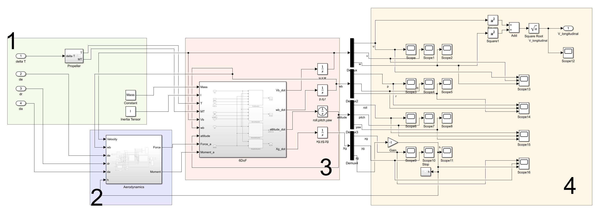
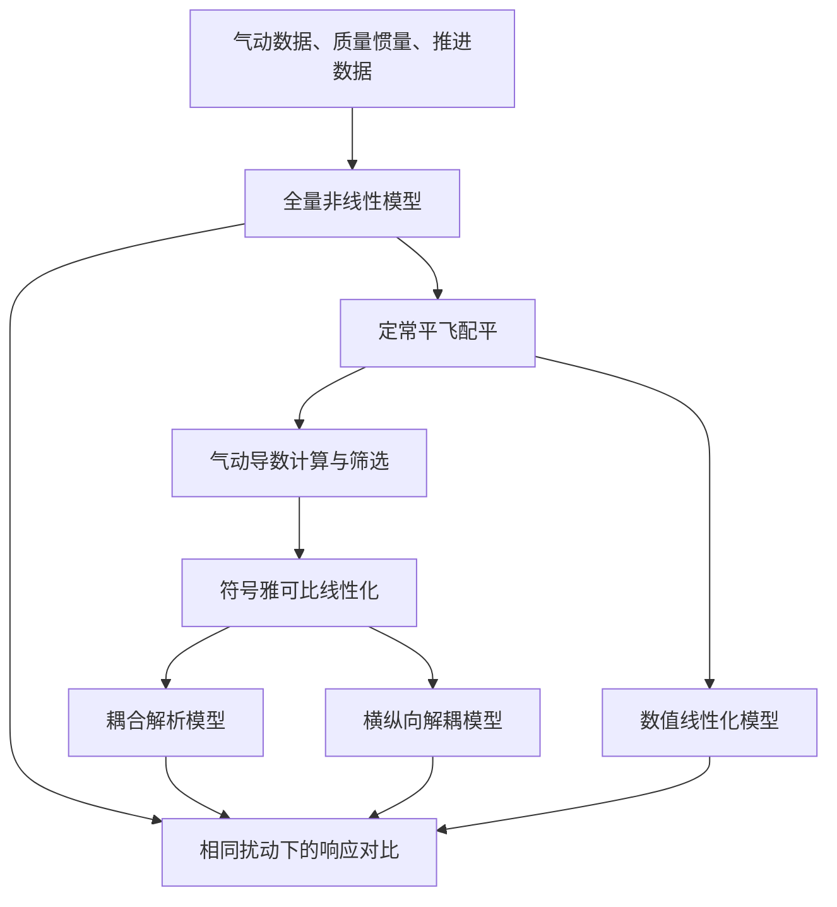
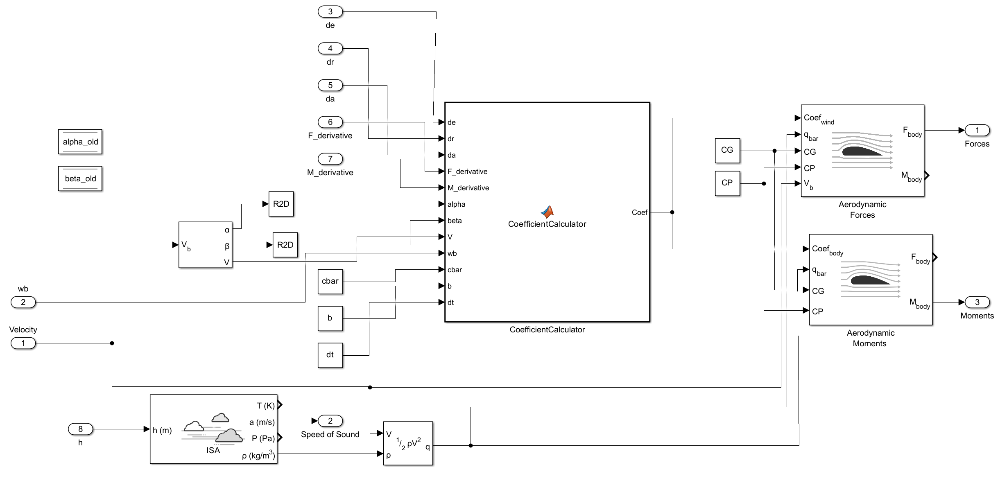
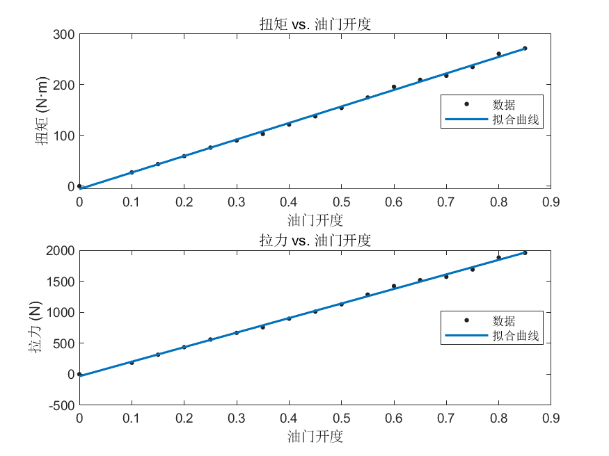

# 固定翼无人机动力学与运动学模型线性化研究

**Linearization of the Full-Order Dynamic and Kinematic Model of Fixed-Wing UAVs**

[中文](#中文说明) | [English](#english)

<a id="中文说明"></a>

## 中文说明

本项目是我在**北京航空航天大学仪器科学与光电工程学院**攻读**探测制导与控制技术**专业期间完成的 **2025 届本科毕业设计（论文）**配套工程。

| 项目 | 内容 |
| --- | --- |
| 论文题目 | 固定翼无人机动力学与运动学模型线性化研究 |
| 完成时间 | 2025 年 5 月 |
| 开发环境 | MATLAB / Simulink R2024b |
| 论文正文 | 仓库根目录的 [`sample-bachelor_A4.pdf`](sample-bachelor_A4.pdf)（点击阅读完整毕业论文） |

**毕业论文正文文件是 [`sample-bachelor_A4.pdf`](sample-bachelor_A4.pdf)，位于本仓库根目录。** 本 README 是项目与代码导览；论文的完整推导、实验结果和讨论请以该 PDF 为准。

研究从固定翼无人机的全量非线性模型出发，完成**六自由度建模、定常平飞配平、解析与数值线性化、横纵向解耦及扰动响应对比**，并研究气动导数筛选对模型精度和动态特性的影响，为后续飞行控制系统设计提供模型基础。



*模型由控制输入与推进、空气动力、六自由度动力学与运动学、输出观测四部分组成。*

### 完成的工作与采用的方法

| 工作 | 方法与实现 |
| --- | --- |
| 建立全量非线性模型 | 基于刚体动力学推导力方程、力矩方程、欧拉角运动学方程与导航方程；保留惯性张量交叉项，在 Simulink 中实现 12 状态模型。 |
| 建立气动与推进模型 | 对原始气动数据进行三维线性插值，组合基本气动项、舵效项及动导数项；使用标准大气模型计算环境参数，并完成坐标变换与力矩参考点补偿。根据油门数据拟合推力和螺旋桨反扭矩。 |
| 求解定常平飞配平点 | 使用 Simulink 配平工具设置状态、输入和输出约束；另构建由运动与状态残差组成的代价函数，使用 `fmincon` 的 SQP 方法搜索配平解。 |
| 解析线性化 | 在配平点附近进行一阶泰勒展开，用插值与有限差分求气动系数偏导数，再通过 Symbolic Math Toolbox 计算状态和输入的雅可比矩阵。 |
| 气动导数筛选与解耦 | 使用无量纲影响因子和阈值筛选气动导数，并分别构建保留横纵向耦合与横纵向解耦的线性模型。 |
| 数值线性化及验证 | 使用 Simulink Model Linearizer 得到配平点附近的线性模型，与全量模型、耦合解析模型和解耦解析模型施加相同扰动，对比短时及长时响应。 |

### 模型与研究流程

全量模型包含 12 个状态和 4 个控制输入：

$$
\mathbf{x}=[u,v,w,p,q,r,\phi,\theta,\psi,x_g,y_g,z_g]^{\mathsf T},
\qquad
\mathbf{U}=[\delta_T,\delta_e,\delta_r,\delta_a]^{\mathsf T}.
$$

其中，`u/v/w` 为机体系速度，`p/q/r` 为机体系角速度，`φ/θ/ψ` 为欧拉角，`xg/yg/zg` 为地面坐标系位置；控制量依次为油门、升降舵、方向舵和副翼。机体系采用**前—右—下**方向，飞行高度为 `h = -zg`。姿态角使用弧度，气动查表中的迎角、侧滑角和舵角使用度。



**非线性建模。** 气动力、重力、推力及螺旋桨反扭矩共同决定运动响应。气动模型根据迎角、侧滑角、马赫数、舵角和高度查询相应数据；将气流坐标系下的力转换到机体系，并通过 `M_CG = M_ref + r × F` 将力矩转移到质心。



**推进模型。** 使用一次多项式拟合油门开度与推力、反扭矩的关系，得到工程中使用的近似模型：

$$
T\approx2347\delta_T-32.38,\qquad
M_T\approx325.9\delta_T-5.774.
$$

这里油门开度为无量纲比例，推力单位为 N，力矩单位为 N·m；拟合所用数据覆盖 0–85% 油门区间。



**配平与线性化。** 论文采用高度约 **500 m**、速度约 **40 m/s** 的定常平飞工况，迎角约为 **2.596°**、马赫数约为 **0.1182**。这里配平指速度、角速度和姿态等保持定常，前向位置仍随时间变化，并非全部 12 个状态的导数都为零。

对非线性方程 `ẋ = f(x,U)` 在配平状态附近求一阶近似：

$$
\Delta\dot{\mathbf{x}}=A\Delta\mathbf{x}+B\Delta\mathbf{U},
\qquad
A=\left.\frac{\partial f}{\partial\mathbf{x}}\right|_0,
\quad
B=\left.\frac{\partial f}{\partial\mathbf{U}}\right|_0.
$$

全状态输出对应 `C = I₁₂`、`D = 0₁₂×₄`。解耦模型将状态分别分为纵向 `[u,w,q,θ,xg,zg]` 和横向 `[v,p,r,φ,ψ,yg]`。

**气动导数筛选。** 为减少解析表达式中的导数项，使用以下影响因子衡量给定扰动范围内，各自变量对气动系数的相对影响：

$$
\eta_i=\frac{\left|\dfrac{\partial c}{\partial\xi_i}\,r_i\right|}{|c_0|}.
$$

当 `ηᵢ ≥ ε` 时保留对应导数，否则置零。`rᵢ` 是所考虑的小扰动幅度；工程中使用迎角、侧滑角及舵角各 3°、马赫数 0.02、高度 100 m。`CalculateInfluence.m` 对零基准值使用很小的替代值以避免除零。

### 仿真对比与主要观察

论文对四个控制输入施加相同形式的高斯脉冲扰动，在约 5 s 时达到峰值，比较以下四类模型：

| 模型 | 对应文件 |
| --- | --- |
| 全量非线性模型 | `SixDegree.slx` |
| 数值线性化模型 | `linear_numerical_model.slx` |
| 耦合解析线性化模型 | `linear_analysis_model.slx` |
| 横纵向解耦解析模型 | `linear_decoupling_model.slx` |

**论文图 4.1：** 从上到下依次为全量非线性、数值线性化、耦合解析线性化、解耦解析线性化模型的 `u` 通道响应。完整图见[毕业论文正文](sample-bachelor_A4.pdf)。

- **短时、小扰动条件下**，各线性模型的响应趋势与全量模型较为一致。
- **长时间仿真中**，模型间差异增大；解耦会阻断横纵向状态之间的影响，因此某个通道看起来更稳定，并不意味着整体模型更准确。
- **气动导数筛选阈值会影响动态特性**。论文比较 `ε = 0、0.2、0.4、0.6`，其中较大的阈值可能舍弃重要导数，使响应和稳定性发生明显变化。

**论文图 4.4：** 从左上至右下，阈值依次为 0、0.2、0.4、0.6。完整图见[毕业论文正文](sample-bachelor_A4.pdf)。

研究主要验证配平点附近的局部近似效果；更多飞行工况、大扰动响应和闭环控制律设计属于后续可扩展方向。

### 工程文件导航

| 文件 | 作用 |
| --- | --- |
| `MATLAB.prj`、`resources/project/` | MATLAB 工程入口及工程元数据 |
| `UnmannedAerialVehicle.m` | 质量、几何尺寸、惯量、质心与气动参考点、推进参数及力矩方程系数 |
| `aeroData_HGDGUO.m` / `.mat` | 气动数据整理脚本及保存的查表数据 |
| `PropulsionSystem.m` | 推力与扭矩拟合、拟合效果评估及绘图 |
| `CostTrim.m` | 基于约束残差代价函数的配平计算 |
| `Derivatives.m` | 配平点气动系数及左右有限差分偏导数 |
| `Evaluate.m`、`CalculateInfluence.m` | 扰动范围设定、影响因子评估与导数筛选 |
| `JacobianAnalysis.m` | 符号线性化及耦合、纵向、横向模型矩阵计算 |
| `op_trim3.mat`、`trim_dialogue.mat`、`linsys1.mat` | 保存的配平工作点、相关会话数据及数值线性模型 |
| `SolveMomentEquation.m`、`SimplifyMomentEquation.m`、`SimplifyCoefficients.m` | 力矩方程推导及符号化简 |
| `MomentEquation.slx`、`reference.slx` | 力矩方程与参考模型相关的辅助验证模型 |
| `*.xlsx` | 气动系数、舵效、动导数及导数整理表 |
| `pictures/` | README 展示图片 |

### 打开与复现

模型保存版本为 **MATLAB / Simulink R2024b**。主要涉及 Aerospace Blockset、Symbolic Math Toolbox 和 Simulink Control Design；独立运行优化配平及拟合评估脚本还涉及 Optimization Toolbox、Curve Fitting Toolbox，以及 `goodnessOfFit` 对应的 System Identification Toolbox。

在 MATLAB 中进入工程目录，打开工程及非线性模型：

```matlab
openProject("MATLAB.prj");
run("UnmannedAerialVehicle.m");
load("aeroData_HGDGUO.mat", "aeroData");
load("op_trim3.mat");
open_system("SixDegree.slx");
```

查看解析与数值线性模型：

```matlab
% 解析模型的加载/初始化回调会运行 JacobianAnalysis.m
open_system("linear_analysis_model.slx");
open_system("linear_decoupling_model.slx");

% 数值模型加载保存的 linsys1 和配平工作点
open_system("linear_numerical_model.slx");
```

复现时注意以下配置：

- `Derivatives.m` 中保存了配平工况；更换工况后，需要同步更新配平点、气动导数计算点及数值线性模型。
- `Evaluate.m` 当前将 `epsilon` 设为 **0.6**。复现其他阈值时应修改该脚本，因为初始化回调会再次运行它，仅在工作区赋值不会保留。
- `PropulsionSystem.m` 开头包含 `clearvars`，宜独立运行；运行后如需继续仿真，应重新加载模型所需变量。
- 比较各模型前，请统一输入扰动、初始条件、阈值和仿真时长。论文中使用的仿真配置不代表所有已保存模型当前都采用相同时长。
- `.mat` 文件包含必要数据与 MATLAB 对象，应随工程保留；`slprj/`、`*.slxc` 缓存及 `epsilons_u.mldatx` 仿真数据检查器会话不属于本仓库的提交内容。

论文正文给出了完整推导、配平设置、模型矩阵与仿真讨论，可结合第 2–4 章及附录阅读。

[切换至 English](#english) · [返回顶部](#中文说明)

---

<a id="english"></a>

## English

This repository contains the MATLAB/Simulink project accompanying my **2025 undergraduate graduation thesis at Beihang University (BUAA)**, completed in the **School of Instrumentation and Optoelectronic Engineering**, majoring in **Detection, Guidance and Control Technology**.

| Item | Details |
| --- | --- |
| Thesis | Study on the Linearization of the Full-Order Dynamic and Kinematic Model of Fixed-Wing UAVs |
| Completion | May 2025 |
| Environment | MATLAB / Simulink R2024b |
| Full thesis text | [`sample-bachelor_A4.pdf`](sample-bachelor_A4.pdf) in the repository root |

**The complete undergraduate thesis is [`sample-bachelor_A4.pdf`](sample-bachelor_A4.pdf) in the repository root.** This README is a guide to the project and its code; use the PDF for the full derivations, results, and discussion.

The project develops a full nonlinear fixed-wing UAV model, computes a steady level-flight trim condition, constructs analytical and numerical linear models, and compares their disturbance responses. It also studies how longitudinal/lateral decoupling and aerodynamic-derivative screening affect the resulting dynamics.


*The four sections cover control inputs and propulsion, aerodynamics, six-degree-of-freedom dynamics and kinematics, and output observation.*

### Work completed and methods

| Work | Methods and implementation |
| --- | --- |
| Full nonlinear modeling | Derived force, moment, Euler-angle kinematic and navigation equations from rigid-body mechanics; retained inertia cross terms and implemented a 12-state Simulink model. |
| Aerodynamics and propulsion | Combined baseline coefficients, control-surface contributions and dynamic derivatives using three-dimensional linear interpolation. Included a standard atmosphere model, frame transformations and moment transfer to the center of gravity. Fitted thrust and propeller reaction torque against throttle. |
| Steady level-flight trimming | Applied state, input and output constraints in the Simulink trimming tools. Also implemented a residual-based cost function and used SQP through `fmincon` to search for a trim solution. |
| Analytical linearization | Used first-order Taylor expansion, interpolation-based finite differences for aerodynamic derivatives, and symbolic Jacobians for the state and input matrices. |
| Derivative screening and decoupling | Used a dimensionless influence factor to select aerodynamic derivatives, then constructed both coupled and longitudinal/lateral-decoupled analytical models. |
| Numerical linearization and validation | Used Simulink Model Linearizer at the trim condition and compared four model variants under the same input disturbances over short and longer simulation intervals. |

### Model formulation

The nonlinear model has 12 states and four control inputs:

$$
\mathbf{x}=[u,v,w,p,q,r,\phi,\theta,\psi,x_g,y_g,z_g]^{\mathsf T},
\qquad
\mathbf{U}=[\delta_T,\delta_e,\delta_r,\delta_a]^{\mathsf T}.
$$

The states are body-frame velocities, body angular rates, Euler angles and ground-frame positions. The inputs are throttle, elevator, rudder and aileron. Body axes point **forward, right and down**, and altitude is `h = -zg`. Attitude angles use radians; aerodynamic lookup angles and control-surface deflections use degrees.

Aerodynamic loads, gravity, thrust and propeller reaction torque drive the nonlinear equations. Forces are transformed from wind axes to body axes, and moments are transferred from their reference point to the center of gravity using `M_CG = M_ref + r × F`.


The propulsion data cover throttle settings from 0 to 85%. First-order fits provide the approximations used in the project:

$$
T\approx2347\delta_T-32.38,\qquad
M_T\approx325.9\delta_T-5.774,
$$

where throttle is a dimensionless fraction, thrust is in N and torque is in N·m.


The representative trim condition is steady level flight at approximately **500 m altitude** and **40 m/s**, with an angle of attack of approximately **2.596°** and Mach number **0.1182**. Trim holds the flight variables steady while forward position continues to change; it does not require all 12 state derivatives to vanish.

Linearization around this condition gives

$$
\Delta\dot{\mathbf{x}}=A\Delta\mathbf{x}+B\Delta\mathbf{U},
\qquad
A=\left.\frac{\partial f}{\partial\mathbf{x}}\right|_0,
\quad
B=\left.\frac{\partial f}{\partial\mathbf{U}}\right|_0.
$$

With full-state output, `C = I₁₂` and `D = 0₁₂×₄`. The decoupled formulation separates longitudinal states `[u,w,q,θ,xg,zg]` from lateral states `[v,p,r,φ,ψ,yg]`.

For aerodynamic-derivative screening, the influence factor is

$$
\eta_i=\frac{\left|\dfrac{\partial c}{\partial\xi_i}\,r_i\right|}{|c_0|}.
$$

A derivative is retained when `ηᵢ ≥ ε` and otherwise set to zero. The perturbation ranges are 3° for angle of attack, sideslip and control-surface deflections, 0.02 for Mach number, and 100 m for altitude. A small substitute denominator handles zero reference coefficients in `CalculateInfluence.m`.

### Simulation comparisons

The thesis applies Gaussian pulses of the same form to the four control inputs, peaking near 5 s, and compares the following models:

| Model | File |
| --- | --- |
| Full nonlinear model | `SixDegree.slx` |
| Numerical linearization | `linear_numerical_model.slx` |
| Coupled analytical linearization | `linear_analysis_model.slx` |
| Longitudinal/lateral-decoupled analytical linearization | `linear_decoupling_model.slx` |

**Thesis Figure 4.1:** From top to bottom: nonlinear, numerical linearization, coupled analytical linearization, and decoupled analytical linearization `u`-channel responses. See the [full thesis](sample-bachelor_A4.pdf) for the figure.

- Under small disturbances over short intervals, the linear models reproduce the main response trends of the full nonlinear model.
- Differences grow over longer intervals. Decoupling removes interactions between longitudinal and lateral states, so an apparently more stable channel does not establish greater overall accuracy.
- Derivative selection changes the dynamics. The thesis compares `ε = 0, 0.2, 0.4, 0.6`; aggressive screening can remove important derivatives and noticeably change the response and stability characteristics.

**Thesis Figure 4.4:** Thresholds from top left to bottom right: 0, 0.2, 0.4 and 0.6. See the [full thesis](sample-bachelor_A4.pdf) for the figure.

The study focuses on local approximations near the selected trim condition. Additional flight conditions, large disturbances and closed-loop control design are directions for extending the work.

### Project files

| File | Purpose |
| --- | --- |
| `MATLAB.prj`, `resources/project/` | MATLAB project entry point and metadata |
| `UnmannedAerialVehicle.m` | Mass, geometry, inertia, reference points, propulsion parameters and moment-equation coefficients |
| `aeroData_HGDGUO.m` / `.mat` | Aerodynamic data preparation and stored lookup tables |
| `PropulsionSystem.m` | Propulsion fitting, fit evaluation and plots |
| `CostTrim.m` | Cost-function-based trimming |
| `Derivatives.m` | Trim-point coefficients and left/right finite-difference derivatives |
| `Evaluate.m`, `CalculateInfluence.m` | Perturbation ranges, influence factors and derivative screening |
| `JacobianAnalysis.m` | Symbolic linearization and coupled/longitudinal/lateral model matrices |
| `op_trim3.mat`, `trim_dialogue.mat`, `linsys1.mat` | Saved operating point, related session data and numerical linear model |
| `SolveMomentEquation.m`, `SimplifyMomentEquation.m`, `SimplifyCoefficients.m` | Symbolic moment-equation derivation and simplification |
| `MomentEquation.slx`, `reference.slx` | Auxiliary validation models |
| `*.xlsx` | Aerodynamic coefficient and derivative tables |
| `pictures/` | README figures |

### Opening and reproducing the project

The models were saved with **MATLAB / Simulink R2024b**. Relevant products include Aerospace Blockset, Symbolic Math Toolbox and Simulink Control Design. The standalone optimization and fitting scripts additionally use Optimization Toolbox, Curve Fitting Toolbox, and System Identification Toolbox for `goodnessOfFit`.

From the project directory in MATLAB:

```matlab
openProject("MATLAB.prj");
run("UnmannedAerialVehicle.m");
load("aeroData_HGDGUO.mat", "aeroData");
load("op_trim3.mat");
open_system("SixDegree.slx");
```

Open the linear models as needed:

```matlab
% Analytical-model callbacks run JacobianAnalysis.m
open_system("linear_analysis_model.slx");
open_system("linear_decoupling_model.slx");

% The numerical model loads linsys1 and the saved operating point
open_system("linear_numerical_model.slx");
```

For consistent comparisons:

- Update the operating point, derivative-evaluation condition in `Derivatives.m`, and numerical linear model together when changing flight conditions.
- `Evaluate.m` currently assigns **`epsilon = 0.6`**. Edit that script to reproduce other thresholds: initialization callbacks rerun it, overwriting a workspace-only assignment.
- `PropulsionSystem.m` starts with `clearvars`; run it separately and reload simulation variables afterward.
- Match the input disturbance, initial conditions, screening threshold and simulation duration across models. Saved model durations may differ from one another and from particular thesis experiments.
- Keep the `.mat` data and MATLAB objects. Generated `slprj/` and `*.slxc` caches, and the `epsilons_u.mldatx` Simulation Data Inspector session, are excluded from version control.

The full derivations, trimming setup, model matrices and simulation discussion are documented in Chapters 2–4 and the appendices of the thesis.

[切换至中文](#中文说明) · [Back to English](#english)
